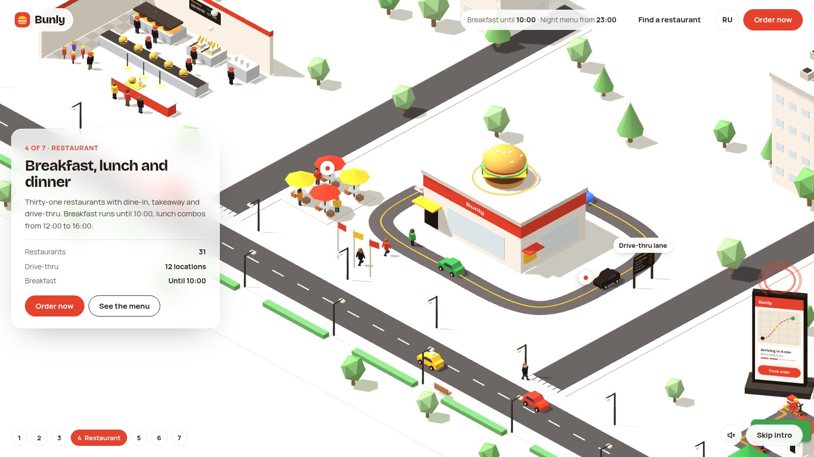

# Bunly — multi-page 3D website concept

<!-- links:start -->
**[🌐 Live demo](https://sergevei.github.io/bunly/)** · **[▶ Video on YouTube](https://www.youtube.com/watch?v=PKqFcx29mDQ)**
<!-- links:end -->

A concept website for a fictional fast-food chain in Belarus. The home page is a scroll-driven isometric 3D tour that follows a meal from local fields to the tray. Around it sits a full site: a menu with a page for every dish, restaurants on a 3D map of Belarus, the company story, the food truck, careers and contacts. Russian lives at the root, English under `/en/`.

Bunly is not a real company. Menu, prices, addresses, phone numbers, emails, figures and reviews are placeholders.

## Pages

| Page | RU | EN | What's on it |
| --- | --- | --- | --- |
| Home | `/` | `/en/` | 3D tour in 7 scenes, menu tabs, favourites slider, 3D map, Club pricing, reviews, FAQ |
| Menu | `/menu/` | `/en/menu/` | 16 dishes in 6 categories, filters (night menu, plant-based, spicy, kids, new) |
| Dish | `/menu/<slug>/` | `/en/menu/<slug>/` | Illustration, price, nutrition, ingredients, allergens, related dishes |
| Restaurants | `/restaurants/` | `/en/restaurants/` | 3D map synced with 31 addresses, search, filters (24/7, drive-thru, delivery, terrace, kids area) |
| About | `/about/` | `/en/about/` | Field-to-tray steps, timeline, partners, values, kitchen tours |
| Food truck | `/food-truck/` | `/en/food-truck/` | Summer tour dates, on-board menu, booking form |
| Careers | `/careers/` | `/en/careers/` | Perks, 7 vacancies with town and area filters, application form |
| Contacts | `/contacts/` | `/en/contacts/` | Hotline, emails, office, feedback form, 10 FAQ answers |
| 404 | any missing URL | | Not-found page in the site's style |

## Features

- Scroll-driven 3D tour (Three.js r128, orthographic isometric camera): farm, bakery, open kitchen, drive-thru, delivery, 24/7 night scene, food truck festival
- 3D dot map of Belarus shared by the home and restaurants pages; picking a town on the map filters the address list
- Every page is real HTML generated at build time: search engines see full text, each page has its own title, description, canonical, hreflang, Open Graph and breadcrumbs (Schema.org)
- Smooth cross-page transitions (View Transitions API, falls back to normal navigation)
- Shared header, mobile menu and footer with a developer block, written once and generated into every page
- Forms (food truck, careers, contacts) validate fields and open a pre-filled email; no server needed
- Light and dark themes, keyboard navigation, reduced-motion support, mobile-first layouts

<!-- author:start -->
## Author

Designed and developed by **Siarhei Vei** — interactive 3D websites built from scratch.

- Telegram: [@vsergeserge](https://t.me/vsergeserge)
- Portfolio: <https://sergevei.github.io/>
- Also see: [NordFreight](https://sergevei.github.io/nordfreight/) · [FutureCall](https://sergevei.github.io/futurecall/) · [OBYN](https://obyn.by/)
<!-- author:end -->
